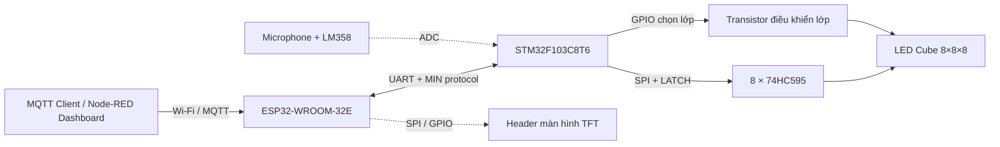

<div align="center">

# LED Cube 8×8×8

**Hệ thống hiển thị LED 3D gồm 512 LED, sử dụng STM32 và ESP32**

Hiệu ứng LED 3D · Quét LED theo lớp · SPI & 74HC595 · UART/MIN protocol · Wi-Fi/MQTT

[**Xem video demo**](Demo/Video_modes.mp4) · [**Altium Project**](Hardware/Design/Design) · [**Schematic (PDF)**](Hardware/Schematic_PDF/Ledcube_8x8x8.pdf) · [**Firmware**](Firmware)

</div>

---

## 1. Giới thiệu

**LED Cube 8×8×8** là dự án thiết kế phần cứng và lập trình nhúng cho khối LED 3D gồm **512 LED**, bố trí thành 8 lớp (mỗi lớp 64 LED). Hệ thống tạo hiệu ứng không gian ba chiều thông qua phương pháp quét LED theo từng lớp ở tần số cao.

Hệ thống sử dụng hai vi điều khiển với nhiệm vụ tách biệt:

- **STM32F103C8T6:** Đảm nhiệm xử lý thời gian thực, quản lý bộ đệm hiển thị, tính toán hiệu ứng và trực tiếp điều khiển quét LED.
- **ESP32-WROOM-32E:** Kết nối Wi-Fi, nhận lệnh điều khiển từ MQTT Broker và truyền xuống STM32 qua giao tiếp UART sử dụng **MIN protocol**.
- **74HC595 & Mạch công suất:** Mở rộng chân IO để điều khiển 64 cột LED và đóng cắt nguồn cho 8 lớp LED.

Repository này bao gồm toàn bộ mã nguồn firmware, file thiết kế mạch trên Altium Designer, Gerber, sơ đồ khối và video chạy thử nghiệm thực tế.

## 2. Video demo

[▶ **Xem video các chế độ hoạt động thực tế**](Demo/Video_modes.mp4)

## 3. Các hiệu ứng LED

| Chế độ | Mô tả |
| --- | --- |
| `MODE_EDGE` | Hiệu ứng sáng chạy dọc theo các cạnh của khối LED |
| `MODE_HEART` | Hiệu ứng nhịp đập hình trái tim 3D |
| `MODE_COUNT` | Hiệu ứng đếm số |
| `MODE_DIAGONAL` | Hiệu ứng quét theo đường chéo |
| `MODE_GROW` | Hiệu ứng khối vuông phóng to và thu nhỏ |
| `MODE_PLANE` | Hiệu ứng dịch chuyển mặt phẳng LED theo các trục |
| `MODE_RAIN` | Hiệu ứng mưa rơi ngẫu nhiên |
| `MODE_SPIRAL` | Hiệu ứng chạy xoắn ốc |
| `MODE_OFF` | Tắt toàn bộ khối LED / Xóa bộ đệm hiển thị |

## 4. Kiến trúc hệ thống



### 4.1. Nguyên lý quét LED

STM32 quản lý trạng thái sáng/tắt của 512 LED thông qua mảng bộ đệm `cube_buffer[8][8]`. Quá trình quét hiển thị diễn ra liên tục theo chu kỳ:

1. Ngắt kích hoạt tất cả các lớp LED để chống lem sáng (ghosting).
2. Đẩy 8 byte dữ liệu của lớp hiện tại qua giao tiếp SPI tới chuỗi 8 IC ghi dịch 74HC595 và chốt dữ liệu (Latch).
3. Kích hoạt transistor cấp nguồn cho lớp LED tương ứng.
4. Chuyển sang lớp tiếp theo và lặp lại.

Nhờ tốc độ quét nhanh cùng hiện tượng lưu ảnh trên võng mạc, mắt người sẽ quan sát được toàn bộ khối LED 3D sáng đồng thời và tạo thành hiệu ứng chuyển động mượt mà.

### 4.2. Điều khiển qua mạng

ESP32 đóng vai trò là gateway nhận bản tin từ MQTT Dashboard (Node-RED), sau đó đóng gói và gửi xuống STM32 qua UART theo chuẩn **MIN protocol**. Phía STM32 giải mã khung truyền và thực thi các lệnh chuyển đổi chế độ (`MODE_HEART`, `MODE_RAIN`, `MODE_SPIRAL`, `MODE_OFF`...) hoặc thay đổi tốc độ chạy hiệu ứng (`SPD:<giá trị>`).

## 5. Phần cứng

| Linh kiện | Chức năng |
| --- | --- |
| **STM32F103C8T6** | MCU chính, xử lý hiệu ứng và điều khiển quét ma trận LED |
| **ESP32-WROOM-32E** | MCU phụ trách kết nối không dây (Wi-Fi/MQTT) |
| **8 × 74HC595** | IC ghi dịch 8-bit, mở rộng 64 ngõ ra điều khiển 64 cột LED |
| **Transistor SS8050** | Đóng/ngắt dòng cho 8 lớp LED |
| **CH340C** | IC chuyển đổi USB-UART hỗ trợ nạp code và debug cho ESP32 |
| **LM358 & Microphone** | Mạch thu và khuếch đại tín hiệu âm thanh đưa vào chân ADC |
| **Header TFT** | Chân cắm mở rộng cho màn hình hiển thị trạng thái |
| **AMS1117** | IC ổn áp nguồn 5V và 3.3V cho toàn mạch |

**Hardware Design Documents:**

- [**Schematic (PDF)**](Hardware/Schematic_PDF/Ledcube_8x8x8.pdf)
- [**Altium Designer Project**](Hardware/Design/Design)
- [**Gerber Files**](Hardware/Gerber)
- [**System Flowchart (draw.io)**](Document/System%20Diagram.drawio)

## 6. Cấu trúc repository

```text
LedCube8x8x8/
├── Demo/
│   └── Video_modes.mp4
├── Document/
│   ├── System Diagram.drawio
│   └── BAOCAO_LEDCUBE_FINAL_07_07_2026.docx
├── Firmware/
│   ├── STM32/
│   │   └── ledcube/
│   └── ESP32/
│       └── Node_Red/
├── Hardware/
│   ├── Design/
│   ├── Gerber/
│   └── Schematic_PDF/
├── Libs/
└── README.md
```

## 7. Trạng thái dự án & Hướng phát triển

**Các tính năng đã hoàn thiện:**
- Thiết kế PCB, lắp ráp phần cứng khối LED 8×8×8 và mạch điều khiển.
- Xây dựng thuật toán quét LED theo lớp, quản lý bộ đệm và chạy ổn định các hiệu ứng 3D cơ bản.
- Giao tiếp truyền nhận lệnh giữa ESP32 và STM32 qua UART sử dụng **MIN protocol**.
- Kết nối Wi-Fi và điều khiển đổi chế độ từ xa qua MQTT / Node-RED.
